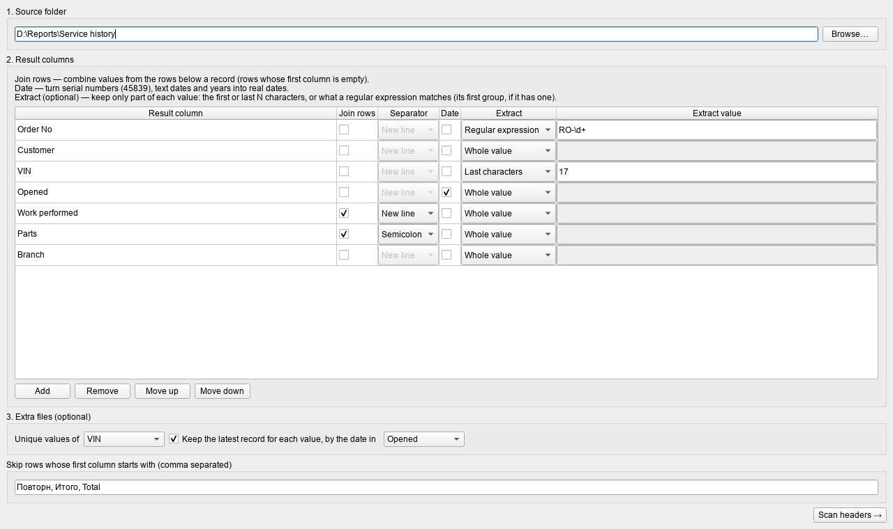
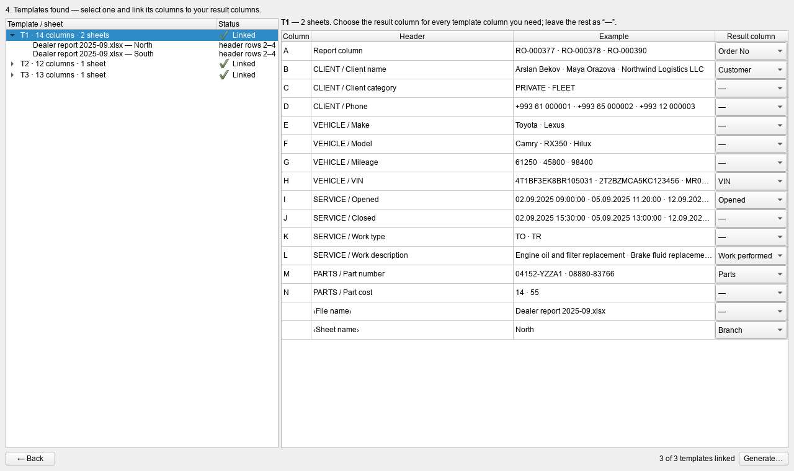
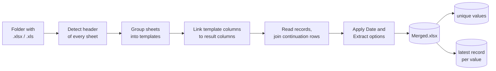

# Merge Excel

**Merge dozens of Excel reports with different layouts into one clean table — without formulas, macros or copy‑paste.**


Monthly exports rarely look the same. Systems change, columns get renamed or translated, headers move down a few rows,
grow a second row of merged group titles, or get a row of field descriptions underneath. On top of that, one record —
a repair order, an invoice, a shipment — is often spread over several rows, with only the first row carrying the key.

**Merge Excel** reads a whole folder of such workbooks, finds the header of every sheet on its own, groups sheets with
the same header into *templates*, and lets you link each template's columns to **your** result columns once.
It then writes a single merged workbook — plus, optionally, a list of unique values and the latest record per value.

<p align="center">
  
  
</p>

---

## Contents

- [Features](#features)
- [Quick start](#quick-start)
- [How it works](#how-it-works)
- [Walkthrough with the bundled examples](#walkthrough-with-the-bundled-examples)
- [Result column options](#result-column-options)
- [Extra files](#extra-files)
- [How sheets are read](#how-sheets-are-read)
- [Settings and privacy](#settings-and-privacy)
- [Development](#development)
- [Limitations](#limitations)

---

## Features

| | |
|---|---|
| **Automatic header detection** | Finds the header anywhere in the first 30 rows. Handles title rows above it, merged group titles (`CLIENT / Client name`), two‑level headers, and description rows below it. |
| **Templates** | Sheets with the same header are grouped, so 50 files with 7 layouts mean 7 mappings, not 50. Header names are compared ignoring case and spacing. |
| **Auto‑linking** | Once a header name is linked in one template, every other template with the same header name is linked automatically. |
| **Multi‑row records** | A row whose first column is empty belongs to the record above. Choose per result column whether to **join** those rows or keep the first value. |
| **Dates** | Excel serial numbers (`45839`), text dates in many formats, month names (EN/RU) and bare years become real Excel dates. |
| **Extract** | Keep only the first/last *N* characters, or what a regular expression matches. |
| **Clean input** | Banner rows (“Repeat repairs: none”), totals at the end, empty and helper sheets are ignored automatically. |
| **Extra outputs** | A list of unique values of any column, and the latest record per value by date. |
| **Formats** | `.xlsx`, `.xlsm` and legacy `.xls`; the real format is detected from the file content, not its extension. |
| **Safe** | Works offline. Source files are opened read‑only and can never be overwritten. |
| **Portable** | One `MergeExcel.exe`, no Python or Office installation required. |

---

## Quick start

### Use the app

1. Build `MergeExcel.exe` (see [Development](#development)) or download it from the CI artifacts.
2. Start it — there is nothing to install.
3. Pick the folder with your workbooks, define your result columns, press **Scan headers**, link the templates and press **Generate**.

### Run from source

```powershell
py -3.10 -m venv .venv
.venv\Scripts\python -m pip install -e ".[dev]"
.venv\Scripts\python app.py
```

---

## How it works



| Step | Screen | What you do |
|---|---|---|
| 1 | Setup | Choose the source folder. |
| 2 | Setup | Add your **result columns** and their options (join rows, date, extract). |
| 3 | Setup | Optionally choose the **extra files**: unique values and latest record. |
| 4 | Templates | Press **Scan headers** — every template is listed with its files, sheets and detected header rows. |
| 5 | Templates | Select a template and link its columns to your result columns (sample values help you choose). |
| 6 | Templates | Press **Generate** and choose where to save. |

---

## Walkthrough with the bundled examples

[`examples/input`](examples/input) contains three workbooks with **fictional** data, one per layout:

| File | Layout | Demonstrates |
|---|---|---|
| `Service history 2023-01.xlsx` | Header in row 1 | Order number inside a sentence, text dates, a `Total` row at the end |
| `Service history 2024-06.xlsx` | Title, empty row, header in row 3 | A merged banner row, dates stored as Excel serial numbers, VIN inside a longer text |
| `Dealer report 2025-09.xlsx` | Two branch sheets, header in rows 2–4 | Merged group titles, a definitions row under the header, real Excel dates |

### Input

**Service history 2024-06.xlsx** (selected columns)

| Row | ORDER NO | CUSTOMER | OPENED | BODY NO | CODE | DESCRIPTION |
|---:|---|---|---|---|---|---|
| 1 | **SERVICE HISTORY — JUNE 2024** *(merged title)* | | | | | |
| 3 | **ORDER NO** | **CUSTOMER** | **OPENED** | **BODY NO** | **CODE** | **DESCRIPTION** |
| 4 | *Repeat repairs: none (merged banner)* | | | | | |
| 5 | RO-000245 | Arslan Bekov | 45446.385417 | VIN 4T1BF3EK8BR105031 | 2119 | Engine oil and filter replacement |
| 6 | | | | | 04152-YZZA1 | Oil filter |
| 7 | | | | | 08880-83766 | Engine oil 0W-20 |
| 8 | RO-000246 | City Transport Agency | 45453.333333 | VIN JTGABCB8606720793 | 3301 | Air conditioner service |

**Dealer report 2025-09.xlsx**, sheet `North` (selected columns)

| Row | A | B | H | I | L | M |
|---:|---|---|---|---|---|---|
| 1 | **Branch report — North** | | | | | |
| 2 | | **CLIENT** *(B–D)* | **VEHICLE** *(E–H)* | **SERVICE** *(I–L)* | | **PARTS** *(M–N)* |
| 3 | **Report column** | **Client name** | **VIN** | **Opened** | **Work description** | **Part number** |
| 4 | *Definition* | *Full name* | *17 characters* | *DD.MM.YYYY* | *as in FRM* | *as in EPC* |
| 5 | RO-000377 | Arslan Bekov | 4T1BF3EK8BR105031 | 02.09.2025 09:00 | Engine oil and filter replacement | |
| 6 | | | | | | 04152-YZZA1 |
| 7 | | | | | Brake fluid replacement | |
| 8 | RO-000378 | Maya Orazova | 2T2BZMCA5KC123456 | 05.09.2025 11:20 | Front wheel alignment | |

The app detects rows 2–4 as the header (column names become `CLIENT / Client name`, `VEHICLE / VIN`, …),
skips the title, the banner and the `Total` row, and recognises that both branch sheets share one template.

### Settings used

| Result column | Options | Linked to (2023 · 2024 · 2025 layout) |
|---|---|---|
| Order No | Extract → regular expression `RO-\d+` | Repair Order · ORDER NO · Report column |
| Customer | — | Customer · CUSTOMER · CLIENT / Client name |
| VIN | Extract → last 17 characters | VIN code · BODY NO · VEHICLE / VIN |
| Opened | Date | RO open date · OPENED · SERVICE / Opened |
| Work performed | Join rows, new line | Description of repair and part · DESCRIPTION · SERVICE / Work description |
| Parts | Join rows, semicolon | — · CODE · PARTS / Part number |
| Branch | — | ‹Sheet name› |

Extra files: **unique values of VIN**, **latest record for each VIN by Opened**.

### Output

All three files are in [`examples/output`](examples/output).

**Merged.xlsx** — one row per order (files in name order, sheets in workbook order)

| Order No | Customer | VIN | Opened | Work performed | Parts | Branch |
|---|---|---|---|---|---|---|
| RO-000377 | Arslan Bekov | 4T1BF3EK8BR105031 | 02.09.2025 09:00:00 | Engine oil and filter replacement<br>Brake fluid replacement | 04152-YZZA1 | North |
| RO-000378 | Maya Orazova | 2T2BZMCA5KC123456 | 05.09.2025 11:20:00 | Front wheel alignment | | North |
| RO-000390 | Northwind Logistics LLC | MR0FR22G4A0550343 | 12.09.2025 08:40:00 | Engine oil and filter replacement | 08880-83766 | South |
| RO-000391 | City Transport Agency | JTGABCB8606720793 | 20.09.2025 13:00:00 | Air conditioner diagnostics | | South |
| RO-000101 | Arslan Bekov | 4T1BF3EK8BR105031 | 03.01.2023 10:12:41 | Engine oil and filter replacement<br>Oil filter<br>Engine oil 5W-30 (4 L) | | Main |
| RO-000102 | Northwind Logistics LLC | MR0FR22G4A0550343 | 04.01.2023 09:30:00 | Front brake pads replacement<br>Front brake pads | | Main |
| RO-000103 | Maya Orazova | 2T2BZMCA5KC123456 | 06.01.2023 14:05:10 | Vehicle inspection | | Main |
| RO-000245 | Arslan Bekov | 4T1BF3EK8BR105031 | 03.06.2024 09:15:00 | Engine oil and filter replacement<br>Oil filter<br>Engine oil 0W-20 | 2119; 04152-YZZA1; 08880-83766 | Main |
| RO-000246 | City Transport Agency | JTGABCB8606720793 | 10.06.2024 08:00:00 | Air conditioner service<br>A/C filter | 3301; 88716-2B030 | Main |
| RO-000247 | Northwind Logistics LLC | MR0FR22G4A0550343 | 18.06.2024 10:45:00 | Engine oil and filter replacement | 2119 | Main |

**Merged - unique VIN.xlsx** — values only, no header, no blanks

```
2T2BZMCA5KC123456
4T1BF3EK8BR105031
JTGABCB8606720793
MR0FR22G4A0550343
```

**Merged - latest by Opened.xlsx** — the newest record for each VIN, newest first

| Order No | Customer | VIN | Opened | Work performed | Parts | Branch |
|---|---|---|---|---|---|---|
| RO-000391 | City Transport Agency | JTGABCB8606720793 | 20.09.2025 13:00:00 | Air conditioner diagnostics | | South |
| RO-000390 | Northwind Logistics LLC | MR0FR22G4A0550343 | 12.09.2025 08:40:00 | Engine oil and filter replacement | 08880-83766 | South |
| RO-000378 | Maya Orazova | 2T2BZMCA5KC123456 | 05.09.2025 11:20:00 | Front wheel alignment | | North |
| RO-000377 | Arslan Bekov | 4T1BF3EK8BR105031 | 02.09.2025 09:00:00 | Engine oil and filter replacement<br>Brake fluid replacement | 04152-YZZA1 | North |

---

## Result column options

Every option belongs to a result column, so it is set once and applies to every template.

### Join rows

Collects the values of a record's continuation rows (rows whose first column is empty) into one cell.
Separators: new line, semicolon, comma, space or slash. Without **Join rows**, the first non‑empty value of the record is kept.

### Date

Converts every value into a real Excel date, shown as `dd.mm.yyyy` (with the time when there is one).

| Input | Result |
|---|---|
| `45839` · `45839,5` | 01.07.2025 · 01.07.2025 12:00:00 |
| `03.06.2024 11:23:10` · `3.6.2024 9:05` | 03.06.2024 11:23:10 · 03.06.2024 09:05:00 |
| `2024-06-03` · `2024-06-03T11:23:10Z` · `2024/06/03` | 03.06.2024 … |
| `03/06/2024` · `03-06-24` | 03.06.2024 (day first) |
| `06/13/2024` | 13.06.2024 (month first, because the day‑first reading is impossible) |
| `20240603` | 03.06.2024 |
| `3 июня 2024 г.` · `June 3, 2024` · `03-Jun-2024` | 03.06.2024 |
| `2003` | 01.01.2003 (a bare year, not serial day 2003) |
| `not a date` | kept unchanged |

### Extract

Optional. Runs **before** Date, so a pattern can pull a date out of a longer text.

| Mode | Value | Input | Result |
|---|---|---|---|
| Last characters | `17` | `VIN 4T1BF3EK8BR105031` | `4T1BF3EK8BR105031` |
| First characters | `5` | `Hereketlendirijiniň` | `Herek` |
| Regular expression | `RO-\d+` | `Repair order RO-000101 from 03.01.2023` | `RO-000101` |
| Regular expression + Date | `from (\S+)` | `Repair order RO-000101 from 03.01.2023` | `03.01.2023` *(first group, as a date)* |

If a pattern finds nothing, the cell stays empty. Invalid settings are reported when you press **Scan headers**.

### Linking tips

- A template you have not edited yet shows **Auto‑linked** when its header names match links made in other templates.
  Names that appear twice in one template are never auto‑linked.
- `‹File name›` and `‹Sheet name›` can be linked like any column — useful for a month or branch column.
- Columns without a header but with data (common in 1C exports) are listed as `(no header)` with sample values.
- If several template columns are linked to the same result column, their values from one row are combined with a space.
- Templates without any link are skipped; the app asks before generating.

---

## Extra files

| Option | File | Content |
|---|---|---|
| Unique values of *column* | `<name> - unique <column>.xlsx` | Each value once, sorted, without header. Empty values and values without letters or digits (`-`, `—`, `.`) are left out. |
| Keep the latest record for each value, by the date in *column* | `<name> - latest by <date column>.xlsx` | One full row per unique value: the one with the newest date, newest first. Rows without a readable date lose to dated ones; on equal dates the first one found wins. |

Dates for “latest” are read with the same converter as the **Date** option, so text dates, serial numbers and real dates compare correctly.

---

## How sheets are read

1. **Header.** Within the first 30 rows, the row with the most distinct text labels (at least three) is the main header row.
   Rows above it with merged group titles are added to the column names (`GROUP / Name`); a single title cell is ignored.
   Merged cells reaching below the main row make it a two‑level header.
2. **Description rows** directly under the header are part of the header when they contain only text, cover at least half
   of the columns, and describe the columns whose data is numbers or dates (e.g. `DD.MM.YYYY`, `km`, `17 characters`).
3. **Records.** A row with a value in the first column starts a record; following rows with an empty first column belong to it.
4. **Noise.** When record keys contain digits (`RO-000245`, `TY00013831`), rows before the first record and rows after the
   last one whose first cell has no digits — banners, totals, signatures — are dropped. Rows starting with one of the
   prefixes in **Skip rows** (case‑insensitive) are always dropped.
5. **Sheets** without a recognisable header (empty sheets, helper lists) are listed as *Ignored* with the reason.

---

## Settings and privacy

- Everything runs locally; the app never connects to the network.
- Source workbooks are opened read‑only; the result can't be saved over a source file.
- Result columns, options, links and the last folder are saved to `%APPDATA%\MergeExcel\profile.json`,
  so next month's files are linked automatically.

---

## Development

```text
merge-excel/
├── app.py                  entry point used for the executable
├── merge_excel/
│   ├── reader.py           .xls / .xlsx reading, merged cells, value clean‑up
│   ├── scanner.py          header detection and templates
│   ├── profile.py          result columns, links, saved settings
│   ├── convert.py          date parsing and extract rules
│   ├── merger.py           record grouping and output workbooks
│   └── ui.py               PySide6 interface
├── tests/                  pytest suite (workbooks are generated on the fly)
├── examples/               fictional input workbooks and the generated output
├── docs/images/            screenshots
├── build.ps1               builds dist\MergeExcel.exe
└── pyproject.toml
```

```powershell
py -3.10 -m venv .venv
.venv\Scripts\python -m pip install -e ".[dev]"
.venv\Scripts\python -m pytest
.\build.ps1
```

`build.ps1` produces a single, self‑contained `dist\MergeExcel.exe` with PyInstaller.
The GitHub Actions workflow runs the tests and uploads the executable as a build artifact on every push to `main`.

---

## Limitations

- The header must be within the first 30 rows of a sheet and contain at least three text labels.
- Ambiguous dates such as `03/06/2024` are read day first.
- Formulas are read through the values Excel saved with the file; workbooks produced by tools that don't store those values read as empty.
- `.xlsb` and `.csv` files are not supported.
- Excel limits a cell to 32,767 characters; longer joined values are truncated.
